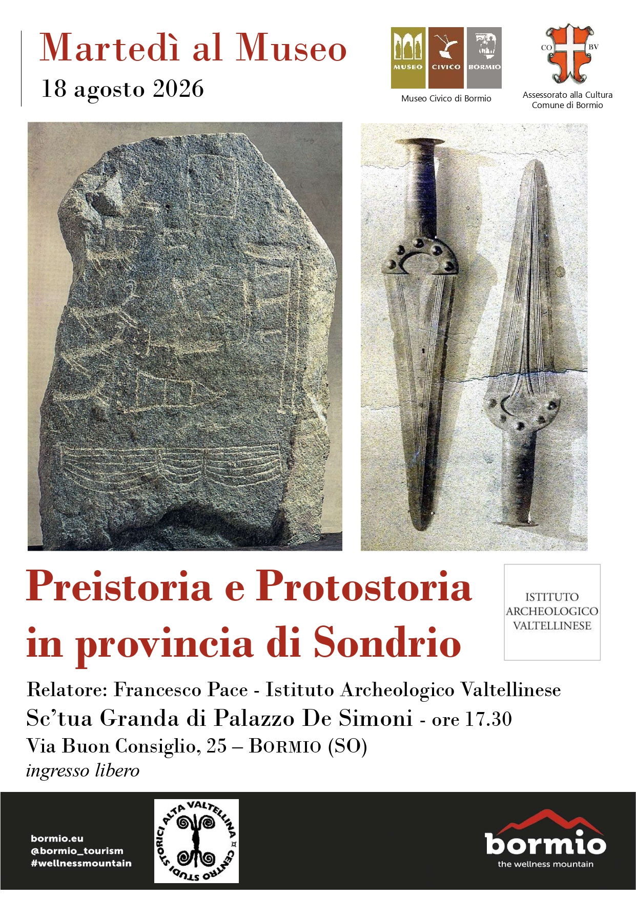

# Preistoria e Protostoria in Provincia di Sondrio: Incontro al Museo Civico di Bormio

[[toc]]

Un affascinante viaggio nel tempo alla scoperta delle origini più antiche della
Valtellina e delle sue valli. **Martedì 18 agosto 2026**, nell'ambito della
rassegna _"Martedì al Museo"_, si terrà la conferenza ad ingresso libero
**"Preistoria e Protostoria in provincia di Sondrio"**.

L'incontro si svolgerà alle **ore 17:30** nella splendida cornice della **Sc’tua
Granda** di **Palazzo De Simoni** (sede del Museo Civico di Bormio), situato in
Via Buon Consiglio 25 a Bormio (SO).

## Il Tema: Le Origini Antiche del Territorio Valtellinese

La provincia di Sondrio racchiude un patrimonio archeologico straordinario,
ricco di testimonianze che vanno dai primi insediamenti umani della Preistoria
fino alle complesse comunità della Protostoria alpine. Durante la conferenza
verranno ripercorsi i passaggi chiave, le scoperte e i reperti che hanno segnato
la storia antica del territorio valligiano.

## Il Relatore: Francesco Pace

A guidare l'incontro sarà **Francesco Pace**, direttore dell'**Istituto
Archeologico Valtellinese**. Grazie alla sua profonda conoscenza della materia e
alla costante attività di ricerca sul campo, Pace offrirà un quadro esaustivo,
rigoroso dal punto di vista scientifico ma al contempo accessibile a tutti gli
appassionati di storia locale, residenti e turisti.

---

## Dettagli e Informazioni Utili per Partecipare

- **Evento:** Conferenza _"Preistoria e Protostoria in provincia di Sondrio"_
- **Rassegna:** Martedì al Museo
- **Data:** Martedì 18 Agosto 2026
- **Orario:** Ore 17:30
- **Luogo:** Sc’tua Granda di Palazzo De Simoni (Museo Civico di Bormio)
- **Indirizzo:** Via Buon Consiglio, 25 – Bormio (SO)
- **Relatore:** Francesco Pace (Istituto Archeologico Valtellinese)
- **Ingresso:** Libero e gratuito
- **Organizzazione:** Assessorato alla Cultura del Comune di Bormio & Museo
  Civico di Bormio
