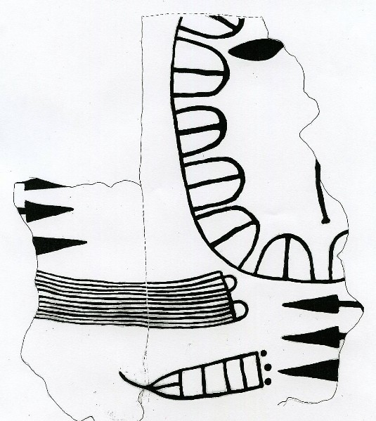
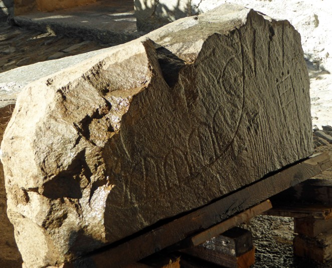
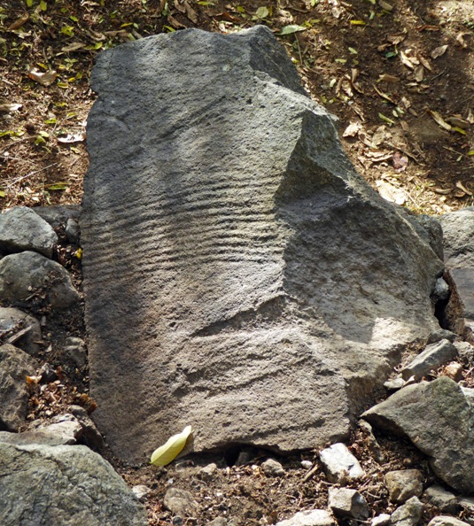
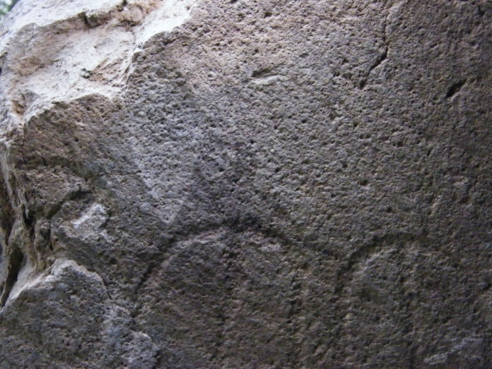
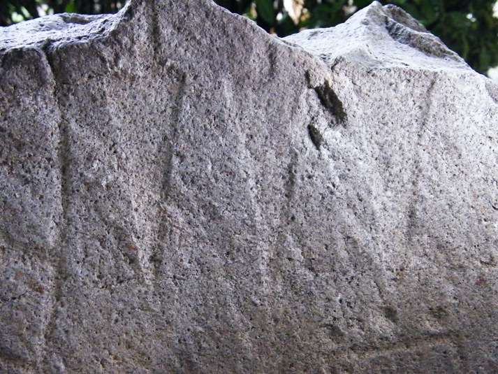

# {{ title }}

La stele Cornal 5 fu scoperta da Ivano Gambarri nel marzo 2004, in un muro di terrazzamento posto a 680 m/slm, che costituisce il lato a monte di una stradina interpoderale orientata in direzio- ne NE-SW posta a Ovest della strada che collega Castelvetro con il centro di Teglio. Il ritrovamento fu segnalato il 13 aprile 2004 alla Soprintendenza per i beni archeologici della Lombardia che, in assenza di fondi, non poté procedere alla rimozione. Nello stesso anno lo scopritore pubblicò la notizia in una breve comunicazione sul Notiziario dell’Istituto Archeologico Valtellinese (Gambarri 2004) e in quell’occasione il frammento fu indicato con la sigla Cornal 4, successivamente modificata in Cornal 5 da S. Casini e A.E. Fossati (Casini e Fossati 2004, 2012).

Questa breve introduzione è tratta direttamente dal documento [Teglio (SO): il recupero della stele Cornal 5](https://media.archeologicovaltellinese.it/cornal/il-recupero-della-stele-cornal-5.pdf) pubblicato sulla Rivista di Scienze Preistoriche.

