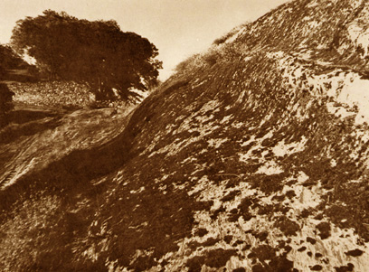
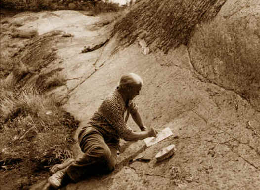
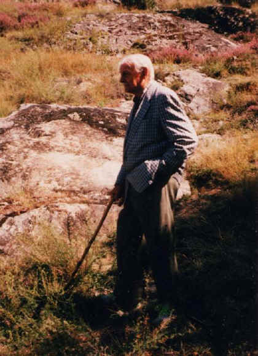
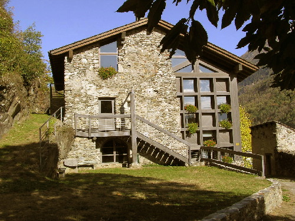
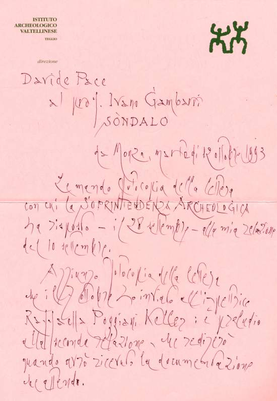
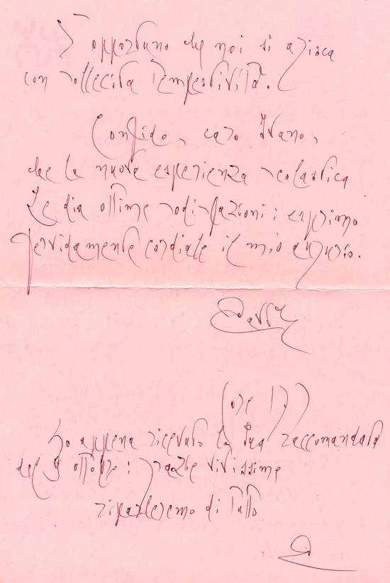

# Il Fondatore: Davide Pace

[[toc]]

## L'Intuizione e la Scoperta della Rupe Magna

> "Improvvisamente - a me perscrutante attentissimo dalla vettura rapida il
> fianco della valle sciorinantesi nuova - apparve fugace l'arce. L'arce che
> presentivo: quale vagamente avevo ambito esistesse, quale mi attendevo che
> anche l'alta Valtellina potesse ostendere". <cite>— Davide Pace, 1969</cite>

Nel 1970 Davide Pace scopre la roccia istoriata più grande delle Alpi, con circa
cinquemila incisioni, alla quale attribuisce il nome di **"Rupe Magna"**.

> "L'avvento archeologico della rupestre silloge glifica di Grosio è premio alla
> fede pertinace di chi - quasi solo - amò credere nella feracità antiquaria
> della valle Tellina". <cite>— Davide Pace, 1970</cite>

La visione di Pace andava oltre la singola scoperta. Aveva già intuito il
potenziale dell'intera area grosina:

> "La caratteristica morfologia delle rupi levigate dall'antico ghiacciaio, lo
> spettacolo mirabile delle arci naturali elevatisi fra l'alveo del Roasco
> irruente e la piana dell'Adda placata, i ruderi ancora grandiosi dei vetusti
> castelli e del vetere tempio dei santi Faustino e Giovita, il sacro poema
> glifico reviviscente su le curve pagine rupestri, il deposito antiquario
> tuttora occulto: tutto proclama la necessità che il dosso del castello assurga
> alla pubblica dignità di «riserva geologica e archeologica»". <cite>— Davide
> Pace, 1970</cite>

## Il Lavoro sul Campo

Il lavoro di documentazione fu immane e richiese uno sforzo fisico e
intellettuale non indifferente.

> "Precipuamente mia la fatica estenuante del calco. Principalmente di Francesco
> Pace la tormentosa traduzione critica del calco in definitivo disegno
> grafico". <cite>— Davide Pace, 1972</cite>

> "Avvinto - saltica la psiche - alla tellina grazia, non accadrà che io vacilli
> o claudichi o allenti, benchè ormai tanto grave dei concitati anni densi: o
> psiche mia, mai tanto ti piacque libera e alta e profonda l'audacia delle
> ali". <cite>— Davide Pace, 1995</cite>

## L'Impegno Didattico in Brianza e Lomellina

Prima della "campagna archeologica valtellinese", Davide Pace si dedicò a
ricerche e indagini nei luoghi della Brianza in cui insegnò, coinvolgendo i suoi
allievi in una vera e propria didattica sul campo.

Fin dal 1955 diede vita in Lomellina, a Groppello Cairoli (PV), ad un museo
locale: l'**Antiquarium laumellinum**, in cui ricoverare i tanti reperti,
soprattutto romani, che riusciva a salvare.

## L'Eredità: Il Parco di Grosio e il Centro Studi

Nel 1978, come auspicato da Davide Pace anni prima, il **Parco delle incisioni
rupestri di Grosio** diventa realtà. Questo traguardo fu possibile anche grazie
alla donazione, avvenuta nel 1982, dei resti dei castelli e dell'area
archeologica da parte della marchesa Margherita Pallavicino Mossi (vedova di
Giovanni Visconti Venosta), ultima erede della nobile famiglia un tempo
feudataria dei manieri grosini.

Nel 1998, con scopo archivistico-museale, viene ristrutturato l'antico edificio
rurale situato all'interno del parco. L'edificio, noto come _Ca del Cap_, viene
dedicato alla memoria dell'archeologo scomparso due anni prima, diventando
ufficialmente il **"Centro studi Davide Pace"**.

## L'Uomo e le Lettere

Davide Pace mantenne i contatti con i suoi più stretti amici e collaboratori
attraverso numerosissime lettere. Queste missive erano vergate con una
personalissima calligrafia che spesso, come per le pergamene antiche, doveva
essere decriptata sia nei segni che nelle parole, frequentemente mutate in
latinismi e arcaismi:

> "Conio della fervida officina lessica di cui pertinacemente mi diletto."

Le lettere viaggiavano in caratteristiche buste gialle, minuziosamente
affrancate con francobolli scelti tra quelli meno comuni, a testimonianza di una
cura per il dettaglio che lo accompagnava in ogni aspetto della vita.

## Le Pubblicazioni

L'instancabile lavoro di ricerca e la profonda vocazione letteraria di Davide
Pace ci hanno lasciato in eredità numerosi scritti, saggi e i celebri _Tellina
Opuscola_.

[Scopri l'elenco completo delle sue pubblicazioni](/davide-pace/bibliografia/)
