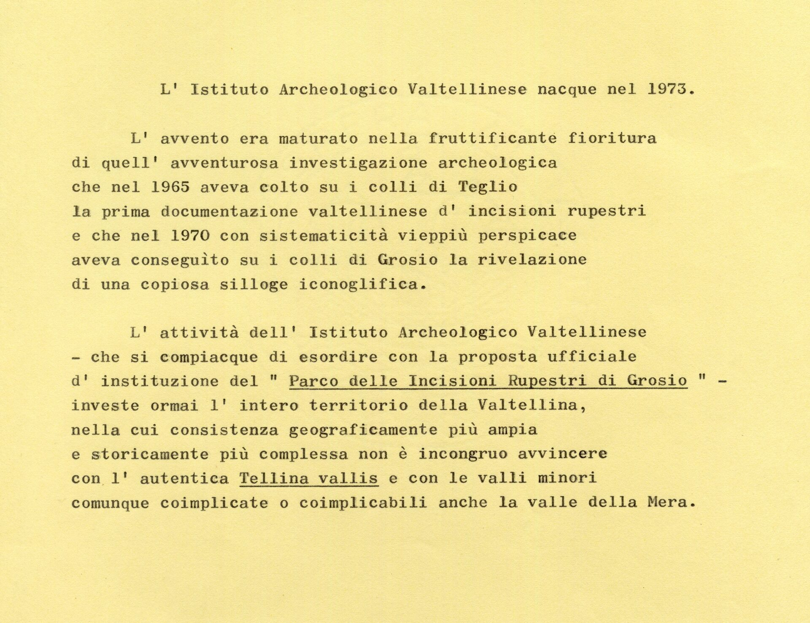

# Reviviscenza dell’Istituto Archeologico Valtellinese

di _Mario Giovanni Simonelli_

Il quattro ottobre 1973 a Sondrio, presso lo studio notarile Surace, si costituì
l’Istituto Archeologico Valtellinese. I soci fondatori:
[Davide Pace](/storie/davide-pace/), Guiscardo Guicciardi, Elisabetta Sertoli,
Carlo Bozzi, Costantino Storti, Francesco Pace e Pierluigi Annibaldi.

Già nella primavera di quello stesso anno, il primo direttore dell’Istituto,
Davide Pace, aveva anticipato alla stampa locale l’avvento della nuova
associazione culturale:

> È nato l’Istituto Archeologico Valtellinese. È nato in semplicità. In alacre
> semplicità intende germinare fiorire fruttificare. È nato dal fervore fausto
> per cui Teglio può comporre nell’Antiquarium Tellinum la stupenda
> documentazione megalitica. È nato dal fervore strenuo per cui Grosio può
> contemplarsi nella rivelatrice magnitudine dell’arcaico monumento
> petroglifico. È nato dall’improvviso rifulgere copioso dell’antichità
> valtellinese, degna di essere perseguita con matura autonoma coscienza ovunque
> la valle dell’Adda e le terre contigue arrisero all’avvento primigenio
> dell’uomo e si stimarono felici dello spirito creatore dell’uomo e si
> dischiusero sacre alle reliquie dell’uomo[^2].

La fondazione dell’Istituto non si concretizzò all’improvviso, apparve,
piuttosto, come frutto maturo della strategia d’amore intrapresa da Davide per
ammaliare gli studiosi e gli incolti valtellinesi ai segreti ancestrali della
propria terra.

La cultura locale, negli anni sessanta, era animata da valenti e stimati
studiosi. Nel benemerito Bollettino della Società Storica Valtellinese si
rispecchia fedelmente la elaborazione culturale di quel prestigioso, ancorché
ristretto, cenacolo[^2]. Davide Pace iniziò la sua collaborazione con la Società
Storica Valtellinese nel 1965, con il saggio _Nuove acquisizione antiquarie nel
territorio di Teglio_[^3]. Lo stile letterario del contributo suscitò non poche
riserve nel comitato di redazione. D’altra parte i reperti illustrati erano
ragguardevoli e non potevano non essere segnalati[^4]. Renzo Sertoli Salis
intervenne personalmente a modificare alcune parti del testo, suscitando le
rimostranze dell’archeologo monzese[^5]. Ad ogni modo l’incontro fecondo con
l’archeologa tellina Maria Reggiani Rajna[^6], con Renzo Sertoli Salis e con
altri studiosi suscitò l’effetto di un sasso lanciato in uno stagno. Così,
infatti, Davide Pace descrisse, con stile inconfondibile, il suo incedere
nell’avventura tellina:

> Non è incongruo né forse è immodesto che io riveli la decisiva influenza che
> l’avvento archeologico delle stele di Valgella e delle incisioni rupestri del
> Doss de la Forca esercitò nel riaccendere vivissimo quel prestigio antiquario
> che repentinamente nel 1941 era stato inaugurato dalle stele di Caven: benché
> alimentato da insigni cultori dell’archeologia petroglifica, si era come
> affievolito allorché nel 1965 io mi accinsi a investigare il territorio
> tellino. La squallida imagine divina di Valgella scosse dal sopore la squisita
> imagine divina di Caven. Il ricomposto letargo della ieratica terra di Teglio
> si ridestò alla prima indagazione sistematica. Gl’intorpiditi cimeli di Caven
> furono sottratti all’umbratile requie del portichetto dei Besta e immessi a
> vivere con i nuovi monumenti la raccolta ma fervida vita del nascente
> antiquarium[^7].

I contadini, i pastori ed i semplici[^8] ebbero un ruolo non secondario
nell’attività pedagogica di Davide. Alcuni rinvenimenti di notevole interesse si
devono proprio allo scavo archeologico nella memoria degli incolti, effettuato
dall’archeologo con singolare efficacia ed intelletto d’amore.

Per trent’anni lo studioso percorse la Valtellina a confermare rinvenimenti, ad
allacciare amicizie, a vivere momenti di gioia profonda con i semplici, a
sensibilizzare insegnanti e pubblici funzionari, a gustare atmosfere arcaiche
con i numerosi amici e ad insegnare sul campo, responsabilmente, la non facile
arte dell’osservazione e del rinvenimento arcaico in superficie.

L’Istituto Archeologico Valtellinese, ovvero Davide Pace, visse fecondo,
attenendosi a questi semplici ma solidi principi, fino al 16 gennaio 1996,
giorno della _agapica metamorfosi_ del maestro.

Dopo un breve periodo di comprensibile smarrimento, il Sac. Carlo Maria Bozzi fu
acclamato secondo direttore dell’Istituto nell’assemblea generale convocata a
Teglio nell’estate del 1998. Don Carlo si spense serenamente il 28 novembre
2001[^9].

Attualmente è stato designato quale direttore Francesco Pace.

A quasi trent’anni dalla fondazione, l’Istituto Archeologico Valtellinese
abbisognava di un adeguamento giuridico e statutario. Grazie alla disponibilità
ed alla liberalità del notaio Giandomenico Schiantarelli nell’assemblea generale
svoltasi a Teglio il 31 luglio 2002, ciò si è positivamente avverato.

Riprende l’avventura della ricerca arcaica in amicizia, aperta ad ogni incontro
e contributo. Chiunque desideri associarsi può richiederlo, senza particolari
formalità, al direttore Francesco Pace (Via Tirso 9, 20052 - Monza).

Il passato dell’Istituto è prestigioso, desideriamo proiettarci verso il futuro
vivendo con intensità operosa il presente. In sintonia con la legislazione
statuale in materia, con la Soprintendenza Archeologica della Lombardia, con gli
Enti locali e con gli istituti di formazione e di cultura presenti sul
territorio.

## Note

[^1]: _Corriere della Valtellina_, sabato 7 aprile 1973.

[^2]:
    Sfogliando, ad esempio, i Bollettini n.16(1962), n.17(1963-64) e n.18(1965)
    i contributi scientifici pubblicati furono elaborati da Renzo Sertoli Salis,
    Tarcisio Salice, Giovanni Busino, Sandro Massera, G.D.Oltrona Visconti, Bice
    Besta, Ugo Cavallari, Olimpia Aureggi, Battista Leoni, G.Battista Gianoli,
    Egidio Pedrotti (presidente della SSV, deceduto il 21.07.1964), Diego
    Guicciardi, Giulio Vismara, Nando Cecini e Davide Pace (dal 1965).

[^3]: _Bollettino della Società Storica Valtellinese_, n. 18(1965), pp. 8.

[^4]:
    Le due stele di Valgella, numerose e importanti incisioni rupestri rinvenute
    al Doss de la Forca e l’esame di una epigrafe romana.

[^5]:
    “_Si offriva imminente l’annua pubblicazione del ‘Bollettino della Società
    Storica Valtellinese’, che mi pareva la sede più congrua per la prima delle
    mie trattazioni telline. Mi furono concesse poche pagine. Predilessi
    estendere quanto possibile l’esegesi comparativa delle due stele che più mi
    affascinavano: le più enigmatiche. Non mi furono accolte che due fotografie.
    I giochi di spazio che opportunamente distinguevano le varie parti della
    composizione non furono rispettati nella stampa: devo supporre che la
    riproduzione fedele non fosse possibile. Anche la forma stilistica, subì
    qualche alterazione: deplorai e deploro che in una serie coordinata di
    domande i punti interrogativi intermedii fossero sostituiti da virgole.
    Spiacevoli ombre nell’incipiente luce di un rapporto fecondo._” (D.Pace,
    _Nuove acquisizioni antiquarie nel territorio di Teglio. Tellina opuscula
    1_, Milano 1972, p. XX)

[^6]:
    “_Fausto l’incontro con Maria Reggiani Rajna: rieccitatasi a veemente ardore
    antiquario, l’acquisitrice dei petroglifi di Caven favorì taluni momenti
    della mia indagazione pertinace, che anche poté talora divenire felice
    impresa comune_” (D.Pace, _Nuove acquisizioni antiquarie_, cit., p.XXI,
    nota 3)

[^7]: D.Pace, _Nuove acquisizioni antiquarie_, cit., p. XXI

[^8]:
    “_Nutra gratitudine Teglio al vecchio Giovanni Branchi, prezioso fomite
    antiquario cui per accendersi provvido non era mancato che il suscitatore
    incontro con un archeologo cui è consuetudine scavare nella sapienza degli
    ignari prima che nel grembo della terra. Pasceva mucche l’adolescente
    Giovanni allorché seduto su una scalucola stupì dell’immagine incisa, gli
    parve strana figurazione femminea: la vaga impressione precorse l’esegesi
    archeologica, l’oscura scoperta del pastorello di Valgella precedette la
    sfolgorante scoperta dell’archeologa di Caven_” (D.Pace, _Nuove
    acquisizioni_, cit., p.4)

[^9]:
    Vds. Hannes, _Nec videar, dum sim. In memoria di don Carlo M. Bozzi_,
    Bollettino della Società Storica Valtellinese. N. 54(2001), pp.7-13.
