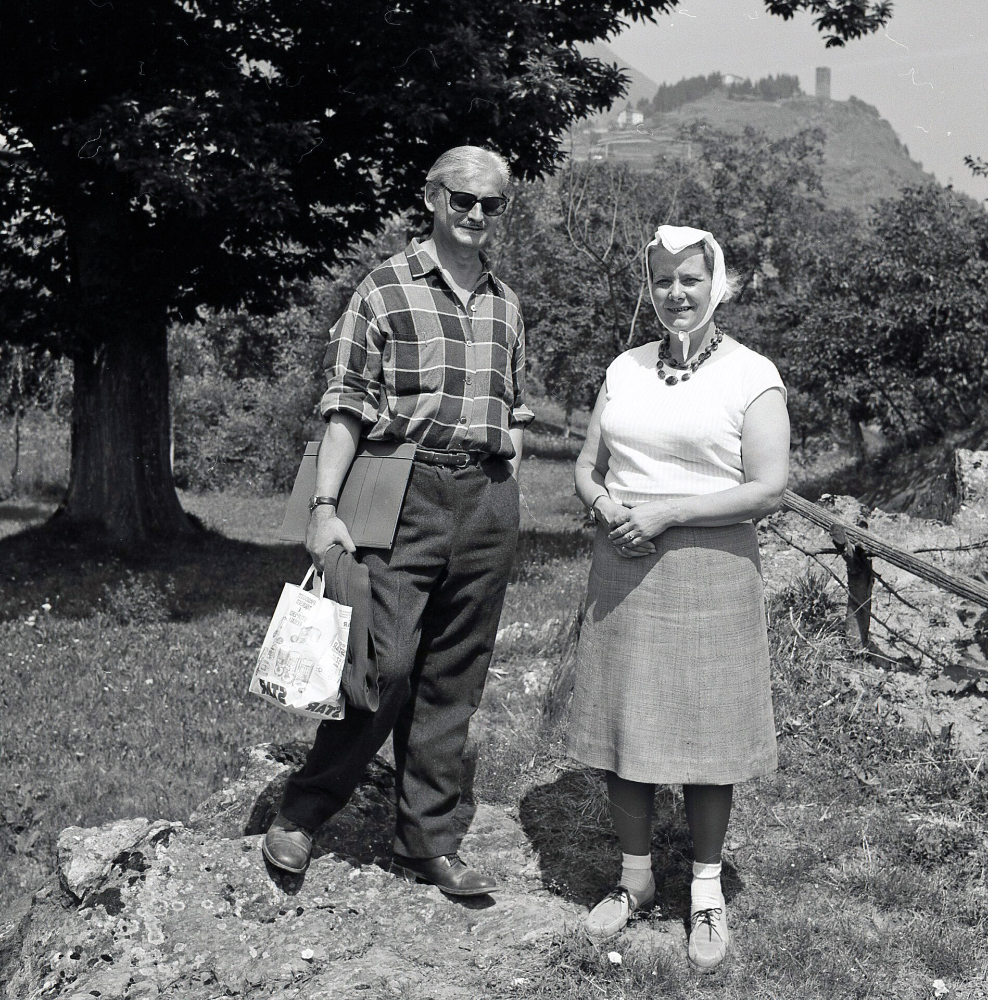

> "Antiquarium Tellinum: tale la denominazione che giudico degna del museo
> archeologico di Teglio. Rapido l'avvento dell'antiquarium. Fu eletta una cella
> spenta del vivido palazzo Besta". <cite>Davide Pace, 1965</cite>

