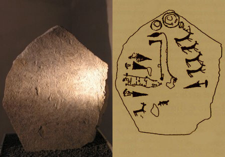
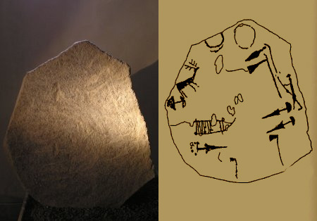
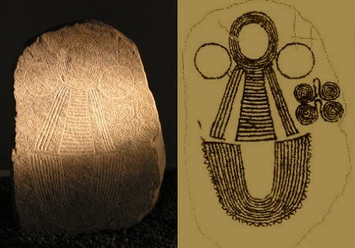
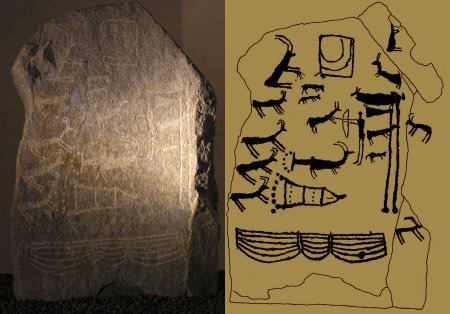
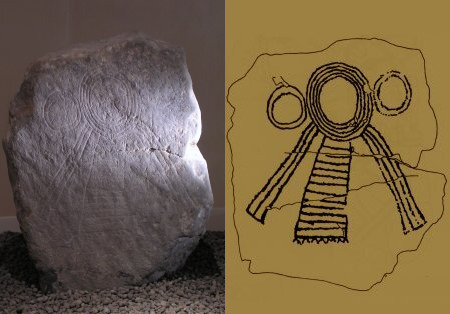
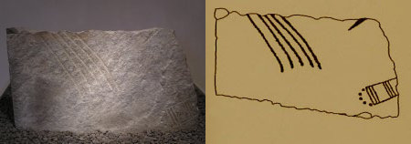
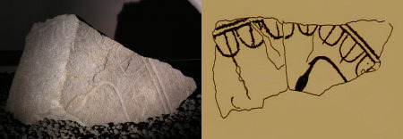
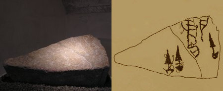
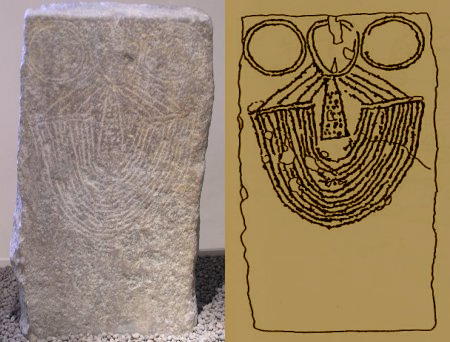

# Antiquarium Tellinum

In questa pagina sono presentate le foto e i calchi delle steli conservate
presso Palazzo Besta a Teglio. Per scoprire di più sulla storia della loro
scoperta si può consultare il
[primo volume del Notiziario dell'Istituto](/pubblicazioni/notiziario/item/1/).

> "Antiquarium Tellinum: tale la denominazione che giudico degna del museo
> archeologico di Teglio. Rapido l'avvento dell'antiquarium. Fu eletta una cella
> spenta del vivido palazzo Besta". <cite>Davide Pace, 1965</cite>

## Stele "Caven 1"

_Scoperta da Maria Reggiani Rajna a Caven - Teglio, nel 1940_

## Stele "Caven 2"

_Scoperta da Maria Reggiani Rajna a Caven - Teglio, nel 1940_

## Stele "Caven 3 - Dea Madre"

_Scoperta da Maria Reggiani Rajna a Caven - Teglio, nel 1940_

## Stele "Tirano-Lovero"

_Scoperta da Gabriele Antonioli e Davide Pace a Lovero, nel 1981_

## Stele "Valgella 1"

_Scoperta da Davide Pace a Valgella - Teglio, nel 1965_

## Frammento stele "Valgella 2"

_Scoperto da Davide Pace a Valgella - Teglio, nel 1965_

## Frammento stele "Valgella 3"

_Scoperto da Davide Pace a Valgella - Teglio, nel 1965_

## Frammento stele "Vangione 3"

_Scoperto da Mario Giovanni Simonelli a Vangione - Teglio, nel 1980_

## Stele "Cornal 1"

_Scoperta da Giovanni Branchi e Davide Pace a Cornal - Teglio, nel 1968_

