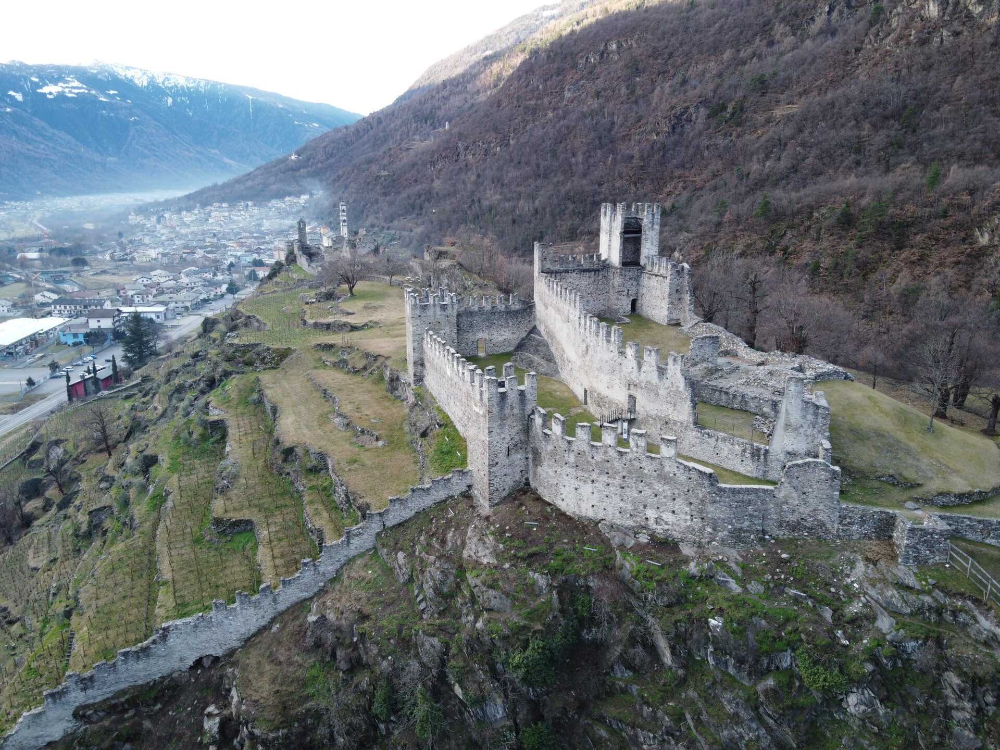
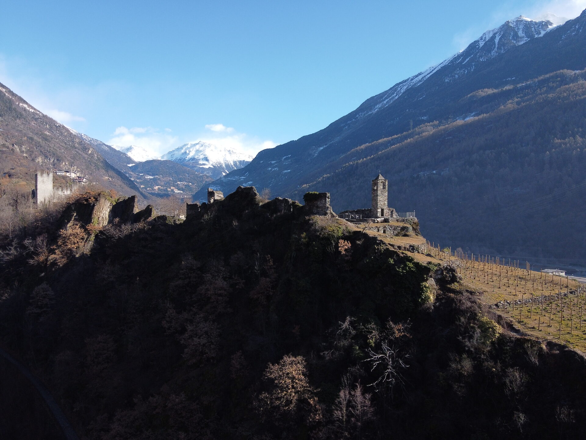
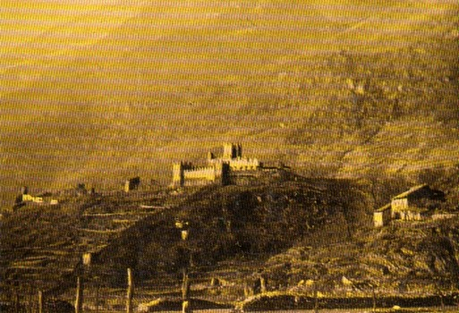
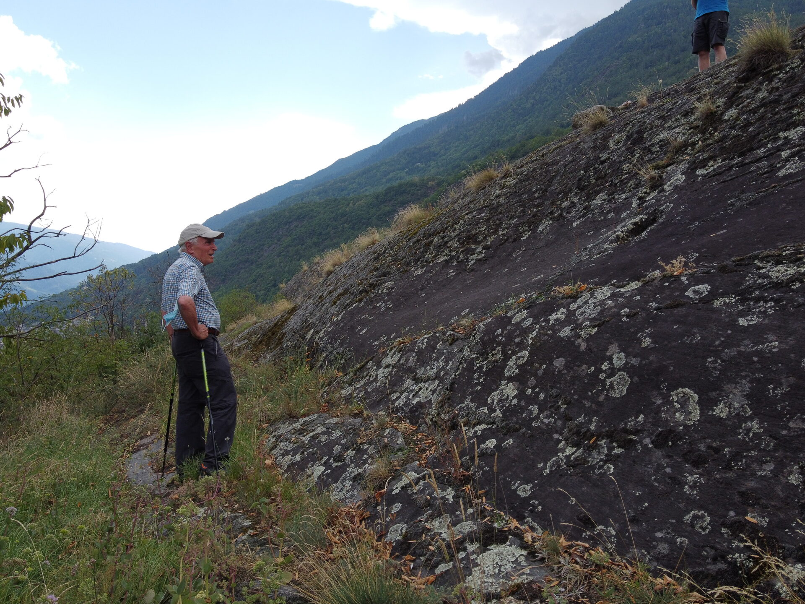
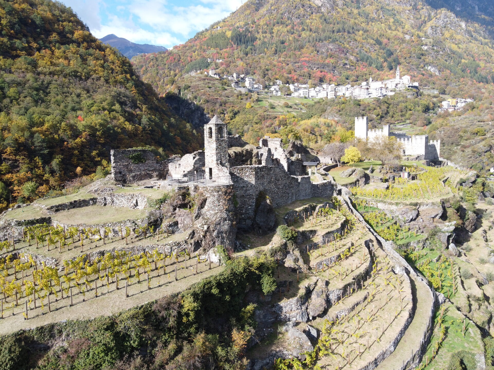
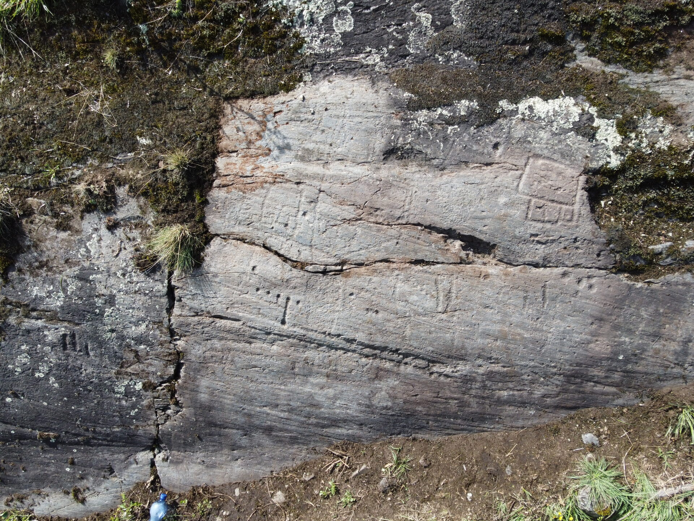
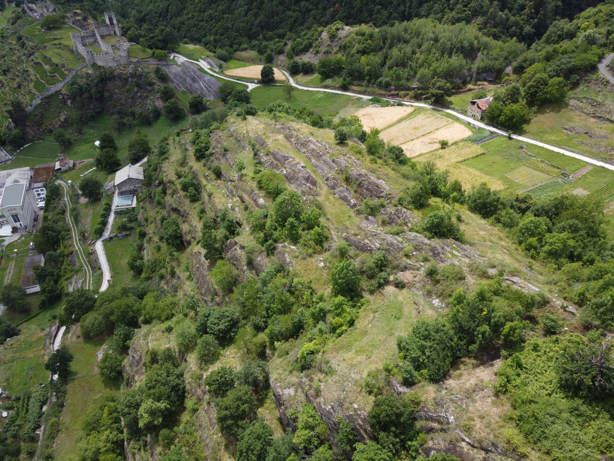

> Grosio, che religiosamente ancora si avvince alla propria natura e alle
> proprie tradizioni. <cite>Davide Pace</cite>

# La Storia dei Castelli di Grosio

_di Gabriele Antonioli_

[[toc]]

La Valtellina e la Valchiavenna sono costellate di numerosi resti di
fortificazioni. Erette in epoca medievale a tutela di diritti e privilegi
feudali, continuano a testimoniare l’importanza strategica attribuita in passato
alle due valli situate a ridosso dei passi alpini. Il forte degrado in cui
versano, dovuto solo in parte alle ingiurie del tempo, è generalmente iniziato a
partire dal 1526 con la requisizione e lo smantellamento imposti dal Governo
delle Tre Leghe nell’intento di privare i territori da poco acquisiti di punti
di riferimento e di forza che avrebbero potuto essere sfruttati in una eventuale
insurrezione. Al di là di qualsiasi considerazione sul contenuto del patto di
Teglio, che avrebbe dovuto sancire rapporti di amicizia se non di fratellanza
fra le nostre valli e il Governo grigione, si può facilmente dedurre che col
rendere inoffensivi questi simboli di potere e di autonomia divenne
inequivocabilmente palese il nostro stato di sudditi.

Nel contesto valtellinese, i resti più cospicui per consistenza e stato di
conservazione sono certamente quelli relativi ai castelli di Grosio. Essi si
incontrano risalendo la valle dell’Adda, sul colle che separa i centri di
Grosotto e di Grosio, dove la Valgrosina confluisce nella Valtellina. Si tratta
di due strutture attigue, realizzate in epoche diverse per rispondere ad
esigenze differenti e non complementari come era stato ipotizzato. Risulta
pertanto quanto meno equivoca la qualifica di castelli gemelli come in alcuni
studi era stata proposta. La più antica fortificazione è evidenziata dallo
svettante campaniletto della cappella castellana mentre la seconda si presenta
dal fondovalle con un’imponente cinta muraria merlata e turrita. I due castelli
si trovano all’interno del perimetro del Parco delle incisioni rupestri e
contribuiscono ad arricchirne le già numerose attrattive. Si ha così la
possibilità di articolare un percorso che spazia dalla preistoria al medioevo,
con interessanti osservazioni di carattere naturalistico.

### La lotta per le investiture e la situazione feudale nella Valtellina

Per inquadrare nel giusto contesto il primo documento che menziona il castello
di Grosio, risalente al 1150, dobbiamo necessariamente premettere alcune
considerazioni di carattere generale sulla situazione politica di allora. Era
quello il periodo nel quale ferveva la lotta per le investiture che
contrapponeva impero e papato, guelfi e ghibellini. Queste contese ebbero viva
ripercussione anche nella Valtellina, per i suoi valichi e per la propria
configurazione geografica guardata sempre con occhio geloso dalle potenze che ne
ambivano il possesso. L’organizzazione territoriale della valle si basava allora
sulla suddivisione in pievi. Queste circoscrizioni avevano valenza
amministrativa e religiosa ed erano governate da un’autorità civile e militare
detta capitano e da una religiosa corrispondente alla figura dell’arciprete.
Differivano dalle altre le pievi di Bormio e Poschiavo dove, invece del
capitanato, vi erano delle avvocazie con diritti regalistici e giurisdizionali
più ampi. Anche Mazzo, da cui Grosio dipendeva, fu sede di pieve e venne
fortificata, ma il vero e proprio baluardo difensivo divenne il castello di
Grosio. La motivazione di tale scelta potrebbe essere stata duplice; sia perché
sede di una preesistente fortificazione sia a motivo della sua posizione
strategica potendo controllare contemporaneamente il corridoio dell’alta
Valtellina, lo sbocco dalla Valgrosina e il passo del Mortirolo. Agli inizi del
X sec. la nobiltà valtellinese era ancora agli albori e le famiglie che
ricoprivano alti incarichi nella valle erano prevalentemente immigrate, tale era
il caso ad esempio dei de Misenti, provenienti dal milanese e capitani della
pieve di Mazzo, e di una nobile famiglia della Val Venosta, i Signori di Matsch
che esercitava, per conto del vescovo di Coira, l’avvocazia sulle pievi di
Bormio e di Poschiavo. L’autorità imperiale concesse a questa famiglia una
ulteriore opportunità per consolidare ed espandere la propria influenza nella
valle dell’Adda allorquando nominò vescovo di Como il loro congiunto Artuico che
resse la diocesi dal 1091 al 1094. È verosimile che questo presule, forse mai
riconosciuto dalla curia comasca e pertanto costretto a risiedere a Bormio sotto
la protezione della propria famiglia, abbia favorito le mire egemoniche dei
propri parenti su tutta l’alta Valle, allargano il loro controllo anche alle
pievi di Mazzo e di Villa e realizzando così una continuità territoriale che
andava da Poschiavo a Bormio. A ridimensionare il ruolo dei Signori di Matsch,
che i documenti iniziano ad indicare semplicemente con l’appellativo de Venosta,
dal nome della valle di provenienza, provvide, dopo alcuni decenni, il nuovo
vescovo di Como Ardizzone che, dopo aver ottenuto dall’imperatore il controllo
sul contado di Chiavenna, volle ribadire la propria autorità anche sulle pievi
di Villa e di Mazzo e il controllo sul castello di Grosio.

### Ipotesi e congetture sull’origine del castello di Grosio

Il documento del 1150, che sanciva tali diritti, ci dà l’opportunità di ribadire
l’esatta denominazione del castello che prende il nome dal colle di Groxio su
cui sorge. I due nuclei rurali, che il documento qualifica come villae ,
figurano come pertinenti al castello stesso e mutuano il loro nome da questo
colle con l’aggiunta di suffissi locativi rapportati alla loro posizione a
monte, e quindi sopra, o a valle, e di conseguenza sotto detta altura. Pertanto
è evidente che non sono i due villaggi di Gros-sura e di Gros-sotto che hanno
dato il nome al castello, come si è soliti credere oggigiorno, ma bensì
viceversa. Occorre anche evidenziare che le vicinie di Gros-sura o Grause
superiore e di Gros-sotto daranno vita ai rispettivi comuni solo in epoca
successiva all’erezione del castello.

Rimanendo in ambito toponomastico merita di essere ricordata la probabile
etimologia di Groxio che i linguisti fanno derivare dall’etimo _crös_ “incavo,
concavo”, attribuibile al sostrato ligure. Questa popolazione di origine
indoeuropea o comunque fortemente indoeuropeizzata avrebbe popolato le nostre
valli prima dell’arrivo dei Celti e, sospinta da altre ondate immigratorie
provenienti dal nord, si sarebbe ritirata progressivamente nei territori della
regione costiera che ne perpetua il nome, la Liguria. Nel dialetto ligure la
_crösa_ indica tuttora il sentiero incavato, il solco. Esiste in effetti
un’analogia fra tale significato e la posizione del colle sul quale sorgono i
castelli di Grosio. Esso infatti è posto a cavallo fra il solco della valle
dell’Adda e la profonda forra scavata dal torrente Roasco che forse servì da
sentiero ai primi esploratori della Valgrosina. Vale la pena anche di
evidenziare come la forma convessa del colle contrapposta a quella concava dei
solchi vallivi sia compendiata nel significato ambivalente di _crös_ che,
nell’accezione attuale, indica tanto la parte interna come quella esterna del
guscio. La toponomastica e la linguistica per il loro carattere conservativo
hanno spesso fornito, attraverso alcune cristallizzazioni, indizi importanti per
la ricerca archeologica e storica.

Quanto evidenziato trova infatti conferma nelle numerose tracce di presenza
umana sui colli di Grosio databili anteriormente all’arrivo dei Celti. La
continuità di tale presenza che elesse i colli grosini a sede abitativa e
cultuale dal neolitico all’età del ferro non ha, per ora, rivelato tracce
significative durante il periodo della romanizzazione se escludiamo sporadici
rinvenimenti di monete imperiali lungo la piana abduana sottostante. È vero che
la ricerca archeologica nella zona può ancora ritenersi allo stadio iniziale e
che non sono state rinvenute tracce delle sepolture, localizzabili forse nella
vallecola che corre dall’abitato di Giroldo al castello, ma per sapere quali
segni abbia potuto lasciare, sarebbe innanzitutto interessante saper quanto
abbia inciso la civiltà romana in questa valle. La Valtellina con i suoi passi
allora strategicamente poco rilevanti rispetto a quelli chiavennaschi
probabilmente rimase marginale ai loro interessi. L’assenza di reperti di epoca
romana non prova automaticamente che i colli di Grosio siano stati abbandonati
durante i primi secoli dell’era cristiana, ma piuttosto che usi, riti e
consuetudini si siano perpetuati dalle epoche più antiche a tutta la fase della
romanizzazione senza sostanziali variazioni. Roma lasciò invece probabilmente
traccia del suo ordinamento amministrativo in quella suddivisione territoriale
che, ricalcando forse una precedente ripartizione, si manifestò nel pagus,
istituzione che raggruppava vari nuclei rurali periferici.

Un’attestazione dell’esistenza di terre appartenenti alla collettività del pagus
si è probabilmente cristallizzata nel toponimo locale _raspagän_. Quanto
all’aggettivo _paganus_, si propende per un collegamento diretto con il suo
significato originario di “pertinente al pagus”, in quanto i terreni “inutiles”,
cioè incolti e improduttivi come in questo caso, unitamente ai boschi e ai
pascoli erano beni che appartenevano, notoriamente, o alla collettività della
circoscrizione del pagus o alla comunità dei residenti nel _vicus_. Tali
proprietà costituiranno poi la base delle comunanze che, in epoca medievale,
motiveranno il sorgere del comune. Meno probabile, benché suggestiva, ci sembra
ipotizzabile un’accezione che muova da _paganus_ inteso come “non cristiano” e
che tale qualifica abbia voluto riflettere l’eco di culti arcaici praticati
sulla sommità del colle sovrastante, ricco per altro di incisioni rupestri e con
tracce di insediamenti dell’età del bronzo.

Il cristianesimo si innestò nel solco della tradizione romana e, con la forza
del suo messaggio di promozione umana, completò anche quella penetrazione
culturale che non era riuscita agli eserciti. La sua capillare diffusione fin
nelle zone più periferiche diede rinnovato impulso e nuove motivazioni anche
alle antiche circoscrizioni pagensi o concilive che si identificarono, a partire
da quel periodo, nei distretti delle pievi. Esse si riconoscevano, nell’alto
medioevo, nella chiesa battesimale, matrice di tutte le chiesi minori. In
seguito la pieve passerà a designare la chiesa del capoluogo nel suo edificio
materiale e nella sua personalità giuridica, cioè la massa di fedeli concepita
corporativamente e congiuntamente alla chiesa stessa. Gli storici ritengono che
le più antiche pievi valtellinesi possano risalire al VI sec., e quella di
Mazzo, da cui Grosio dipendeva, potrebbe essere annoverata fra queste.

### Vicende storiche riguardanti il castrum de Groxio detto anche castello vecchio o di san Faustino

Come abbiamo già ricordato, nel 1150 il vescovo di Como aveva riconfermato ad
Artuico de Venosta e a suo figlio Eganone il capitanato sulla pieve di Mazzo,
già goduto in precedenza da Bertaro de Misenti, riservandosi la giurisdizione
diretta sul castello di Grosio e su tutte le terre pertinenti a detta
castellanza. Placate le animosità e ristabiliti i rispettivi ruoli, in epoca
successiva ritroveremo nuovamente i Venosta come custodi della rocca di Grosio
ma non è ben chiaro quando ciò sia avvenuto. Nella investitura fatta da Enrico
della Torre, che resse la diocesi comasca tra il 1161 e il 1167, venivano
riconosciuti a questa famiglia diritti e prerogative che il vescovo in
precedenza si era riservato quali la giurisdizione penale e il fodro regale
oltre ad una rendita di 60 mogge da esigersi in Grossura. Benché non se ne
faccia esplicita menzione, si ipotizza che già in quella occasione, con la piena
investitura dei diritti capitaneali sulla pieve, anche il castello grosino sia
ritornato sotto il controllo dei Venosta. Se così fosse, a partire da questo
momento le vicende della fortificazione, che rimarrà comunque di proprietà
vescovile fino al XV sec., saranno strettamente legate alle alterne fortune di
detta famiglia.

Una riconferma della precedente investitura, senza ulteriori specifiche, fu
sancita anche dal vescovo Anselmo nel 1187. All’inizio del XII sec. la famiglia
Venosta aveva accresciuto il suo prestigio e accumulato un cospicuo patrimonio.
La vastità degli interessi e delle proprietà che andavano dall’alta valle
dell’Adda a quella dell’Inn e al versante atesino sono documentati nella
spartizione della sostanza lasciata da Gabardo ai figli Gabardino, Egano e
Corrado, avvenuta nel 1226. Purtroppo possediamo solo l’elenco della sorte
toccata a Gabardino, al quale andarono oltre a terreni e affittanze anche alcune
delle fortificazioni possedute o semplicemente presidiate da detta famiglia con
le rendite inerenti. Fra queste sono ricordate le torri di Pedenale, di Sparso,
di Nova, di Sernio e quella di Glurns sul versante atesino. Nell’elenco non
figura il castello di Grosio che probabilmente passò in sorte a Corrado
unitamente al feudo paterno di Mazzo come sembra emergere dalla riconferma
dell’investitura feudale fatta nel 1266 dal vescovo Raimondo della Torre.

Corrado non si limitò ad amministrare i suoi possedimenti e a riscuotere le
copiose rendite ma prese parte attiva alle lotte che contrapponevano il partito
guelfo a quello ghibellino, schierandosi apertamente a favore della fazione
comasca dei Rusconi rivale dei guelfi Vitani. Sarebbe lungo tracciare le vicende
avventurose che lo videro intrepido protagonista e ci limiteremo pertanto a
ricordare unicamente l’avvenimento che interessa più direttamente la nostra
trattazione. Nel 1270 il vescovo comasco Raimondo della Torre, esponente del
partito guelfo, entrava in Valtellina forse per compiervi una visita pastorale o
forse per soggiogare le famiglie ribelli. Fra queste doveva esserci quella dei
Venosta che, secondo alcuni storici, non aveva prestato il giuramento richiesto
dal vescovo per sostenere la causa guelfa. Corrado lo aspettò asserragliato nel
castello di Boffalora con l’intenzione di resistergli. Il Pedrotti sostiene che
“forse Corrado era già stato privato del castello di Grosio, se a quelle forti
difese aveva preferito quelle del piccolo castello che guardava la corte di
Sondalo, già civilmente separata dalla pieve di Mazzo benché ne facesse parte
ecclesiasticamente”. Il Venosta attese dunque l’arrivo del vescovo e, con
un’audace sortita, lo fece prigioniero resistendo poi per tre anni nella rocca
di Boffalora ad ogni tentativo di assalto. Quando l’assedio si concluse, a
Corrado fu comminata la scomunica da parte degli inquisitori e il castello fu
smantellato ma agli altri difensori fu concessa una resa dignitosa che prevedeva
l’onore delle armi. Nel contempo la parte guelfa, per premunirsi contro altre
sorprese, aveva restaurato e fortificato quello di Grosio.

Gli effetti della scomunica di Corrado ebbero ripercussioni limitate nel tempo
verso i suoi discendenti perché nel 1299 il vescovo Leone reinvestiva il nipote
Corradino del paterno e antico feudo nella pieve di Mazzo già tenuto in passato
dalla sua famiglia. Corradino abitava nel castello di Pedenale di Mazzo ma i
suoi figli Artuico e Federico presidiavano quello di san Faustino. In questo
periodo la Valtellina veniva riorganizzata da punto di vista amministrativo con
l’introduzione di circoscrizioni più ampie dette terzieri. La pieve continuava a
svolgere le sue funzioni dal punto di vista ecclesiastico con l’arciprete quale
diretto collaboratore del vescovo sul territorio. Scompariva invece la figura
del capitano di pieve in quanto le competenze in materia di giustizia, di difesa
e di fisco erano passate al podestà che reggeva il terziere. Di conseguenza
veniva ridimensionato anche il ruolo dei castelli di pieve. Ciò nonostante
l’importanza attribuita dai vescovi comaschi al castello di Grosio e la vigile
custodia dei diritti e delle prerogative feudali traspare apertamente nelle
formalità dell’investitura fatta il 19 maggio 1355 da Rigaldo Astorgi, vicario
generale del vescovo Bernardo, a favore di Giuliano figlio di Artuico e del
nipote Federico. Nell’atto di affidamento della rocca di san Faustino è
ricordato il conferimento materiale delle chiavi che attribuiva diritti e poteri
a chi le riceveva ma ricordava anche il pieno e assoluto diritto di possesso da
parte del vescovo.

Per quanto riguarda i beni della mensa vescovile, dobbiamo tener presente che
con l’avvento dei Grigioni nelle nostre valli stava diventando sempre più arduo
il controllo e l’esazione dei canoni dovuti. Il vescovo di Como, al fine di
evitare di vedere vanificata ogni legittima pretesa, preferì monetizzare e
incentivò quindi una politica che ne agevolasse il riscatto. Non abbiamo una
documentazione che comprovi l’affrancamento del castello da parte dei Venosta ma
lo possiamo supporre da una permuta effettuata il 12 febbraio 1522 fra Nicolò fu
Faustino Venosta, abitante nel castello di san Faustino, e suo fratello Germino.
In tale cambio, che riguarda alcuni ambienti all’interno del castello,
sembrerebbe che i Venosta disponessero della piena proprietà della struttura
perché Germino si riservava il diritto di poter costruire all’interno della
corte in prossimità della chiesa di san Faustino. L’atto è interessante anche
perché dai dettagli della permuta è possibile una ricostruzione parziale della
planimetria del castello stesso.

Come per altro è stato confermato anche dai recenti scavi, la costruzione si
sviluppava con andamento longitudinale assecondando la morfologia del colle. Gli
ambienti, di ampiezza modesta, erano disposti su più piani e si trovavano
addossati alla cinta muraria. Per tutta la lunghezza al centro correva una corte
che divideva e dava luce alle costruzioni disposte sui due lati e verso la quale
spiovevano i tetti ad una sola ala, coperti da scandole. Gli scoli dell’acqua
piovana erano convogliati verso una cisterna interna. Nell’atto si ricorda la
presenza di forni, di cucine, di stue, di dispense e di cantine che confermano,
se mai ce ne fosse bisogno, le caratteristiche residenziali della struttura. In
altra sede esprimevo l’opinione che “la relativa angustia del fabbricato,
costretto a seguire la morfologia frastagliata dell’altura, farebbe pensare più
che a un opera difensiva vera e propria ad una prestigiosa affermazione
dell’autorità e del potere del feudatario che vi dimorava, intento a riscuotere
i tributi dai sudditi”. In effetti l’assenza di torri e la relativa modestia
delle altre opere difensive dovevano far apparire la costruzione come una dimora
fortificata piuttosto che come un temibile fortilizio. Non si spiegherebbe
altrimenti il fatto che il decreto di smantellamento dei castelli valtellinesi
del 1526 non abbia interessato anche il castello di san Faustino che risultava
ancora abitato da vari membri della famiglia nel 1586. L’assenza di riferimenti
archivistici dopo tale data ci induce a credere che sul finire del XVI sec. la
struttura sia stata progressivamente abbandonata. Venute meno quelle motivazioni
legate al prestigio del blasone o più semplicemente alle rendite che in passato
competevano alla custodia del castello, la fortificazione perse fascino e
appetibilità. Se a ciò aggiungiamo la dislocazione disagiata unita alla
necessità di radicali interventi di restauro possiamo comprendere le motivazioni
che indussero i Venosta, che ancora vi abitavano, a trasferire la loro residenza
in dimore più confortevoli nei centri del fondovalle di Grosio e di Grosotto.

### La chiesa dei santi Faustino e Giovita

All’estremità meridionale del colle dei castelli di Grosio è posta la chiesa dei
santi Faustino e Giovita. Benché i muri perimetrali siano stati completamente
rasi al suolo a seguito dello sfruttamento della superficie a scopi agricoli
avvenuto nel corso del XVIII-XIX sec., l’area su cui sorgeva è facilmente
individuabile attraverso la piccola torre campanaria che ne affianca l’abside.
Una relazione di fine 1800, ci fornisce i seguenti elementi descrittivi: “Come
tutte le chiese de’ primi secoli della predicazione dell’Evangelio, anche questa
aveva l’altare a levante, che guardava a occidente, e ciò è mostrato anche oggi
dal muro semicircolare rimasto sulla roccia a sfidare le secolari intemperie e
le mani vandaliche. Si entrava per due porte, l’una in comunicazione col
castello, verso nord, e l’altra a ovest che metteva all’abitazione del
beneficiato. Era a volta interamente dipinta, come l’attestano gli intonaci
delle rovine esistenti tuttavia sotto il leggero strato di terra coltivata a
vigna, che invero è alimentata dai calcinacci. Sotto il pavimento, sorretto da
volta, era un sotterraneo che riceveva luce da mezzodì, e che forse serviva per
tomba de’ sacerdoti e comandanti del forte”. Avremo modo più oltre di commentare
e di puntualizzare alcune di queste affermazioni che comunque ci forniscono già
una globale descrizione della costruzione.

Circa le origini dell’edificio, si sono già vagliate le possibili motivazioni
della sua dedicazione ai due martiri bresciani. Si è anche accennato alle tre
fasi di interventi che l’hanno caratterizzato, trasformandolo dal piccolo
sacello funerario alto medievale alla più ampia struttura del X-XI sec.
L’edificio è stato spesso identificato dagli studiosi come cappella castellana,
funzione che certamente svolse dall’epoca del suo ampliamento definitivo, ma
tale qualifica risulta riduttiva per motivi che andremo a commentare. Innanzi
tutto le sue origini non necessariamente sono da collegare con quelle della
struttura castellana vera e propria. Una tradizione popolare affermava che “la
chiesa è di data anteriore al castello”. Il ritrovamento di frammenti di
ceramica retica all’interno del perimetro della chiesa, venuti alla luce durante
i recenti scavi, oltre a documentare una frequentazione del sito in epoca
preistorica potrebbero forse anche indicare che già allora l’area era stata
prescelta per riti cultuali e che tale elezione sacrale sia continuata fino
all’epoca alto medievale. In secondo luogo, benché la chiesa compaia più tardi
come patronato dei castellani Venosta, essa non era in uso esclusivo a tale
famiglia, ma aperta al culto di tutta la popolazione. Ciò è testimoniato, dal
punto di vista strutturale, dalla sua collocazione esterna al castello vero e
proprio e dai due accessi che aveva.

Per quanto riguarda la sua pubblica fruizione vi è poi una leggenda locale
ancora molto viva fra la popolazione che narra come, in epoca alto medievale,
gli abitanti di Grosio si fossero miracolosamente salvati da una rovina che
aveva ricoperto il paese in quanto si trovavano tutti ad assistere alle funzioni
religiose nella chiesa dei santi Faustino e Giovita. Si tratta di una tradizione
che si rifà ad un tempo lontano e indefinito e perciò di difficile verifica ma è
significativo che nel racconto si faccia riferimento a questa chiesetta e non a
quella più accessibile di san Giorgio, forse però non ancora costruita. Una
frequentazione pubblica della struttura traspare anche dalla consuetudine
antichissima praticata dai fedeli di Grosio di compiervi una stazione, a dire il
vero non solo di carattere religioso, tanto nell’andata come nel ritorno delle
processioni rituali verso la chiesa pievana di Mazzo.

Nel 1469 ser Castello fu Olderico Venosta, abitante nel castello di san
Faustino, lasciava in legato ai “pauperes Christi de Groxio” un fitto di 35
staia di biade dovuto annualmente dal comune di Grosio con l’obbligo della
distribuzione del corrispettivo in pane, formaggio e vino. Una parte doveva
essere elargita “ad ecclesiam ipsius terre de Groxio” il giorno di san Marco, il
rimanente “distribuantur ut supra annuatim personis dicti communis Groxii que
annuatim et prout per tempora contingerint venire seu ire ad ecclesiam Sancti
Faustini sitam in suprascripto castro Sancti Faustini, et que postea ire debeant
ad letaneas usque ad ecclesiam Sancti Stefani de Maze, in recessu a dicta
ecclesia Sancti Faustini”. La chiesa si trovava sul confine dei paesi di Grosio
e di Grosotto e, a tal proposito, troviamo un curioso accenno già nel lodo
arbitrale del 4 novembre 1540 che poneva fine alle contese sorte fra i due
comuni. Nella dettagliata relazione che partiva dalla Valgrosina e si concludeva
sul versante orobico si cita come punto divisorio anche la chiesa dei santi
Faustino e Giovita. Il confine passava infatti attraverso la finestrella mediana
dell’abside della chiesa in modo tale che tutte le costruzioni esistenti su quel
dosso e il castello fossero da intendersi sul territorio di Grosio.

Con l’abbandono del castello da parte dei Venosta anche la chiesetta iniziò un
lento decadimento sebbene continuasse ad avere un suo beneficiale. Di ciò
veniamo ragguagliati puntualmente nei verbali delle visite pastorali effettuate
a cavallo del 1600. Il Ninguarda nel 1589 affermava che sopra il colle, a lato
del castello diroccato “est ecclesia Sanctis Faustino et Jovitae dicata, et
dotata; jus praesentandi beneficiatum spectat ad haeredes quondam d. Ulderici
Quadri et haeredes quondam d. Castelli Venusta et penes hanc ecclesiam sunt
aliquot aedes rusticales”. Qualche ragguaglio in più sullo stato della chiesa lo
abbiamo dai decreti emanati in tale visita: “Alla chiesa di san Faustino e
Giovita si rifaccia il crostato di pittura alla cappella maggiore troppo vecchia
e cadente; et all’altare mancano i cancelli”. A queste bonarie raccomandazioni
del vescovo Ninguarda seguirono quelle ben più drastiche dei suoi successori.
Nel 1614 l’Archinti, considerate le carenze strutturali e di paramenti,
decretava il divieto di celebrarvi. L’ultimo vescovo che la vistò fu
probabilmente il Carafino che nel 1629 ribadiva: “Nella chiesa dei santi
Faustino e Giovita del castello si faccia un altare in prospetto della porta con
la sua bradella alla forma e si provvegga de paramenti”.

La fiscalità dimostrata dai vescovi nella puntuale applicazione dei decreti del
concilio tridentino unita alla carenza di mezzi per interventi radicali di
restauro e per una più dignitosa dotazione di paramenti decretarono praticamente
la chiusura al culto e il rapido decadimento della vetusta struttura. Poco dopo
la caduta della volta della chiesa, che si pensa sia avvenuta attorno al 1790,
andò in rovina anche il campaniletto che in alcune cartoline di fine ‘800
compare sbrecciato sul lato occidentale e senza cuspide. Gli interventi di
restauro di questo furono realizzati agli inizi del 1900 perchè, alla morte del
marchese Emilio Visconti Venosta nel 1914, l’arrivo della salma nel territorio
di Grosio fu salutata col tocco di una campana appositamente issata su quella
torre. Gli ultimi interventi alla copertura del campanile si ebbero solamente
nel 1950 quando fu nuovamente issata la croce patriarchina, probabilmente
rinvenuta in loco, e che testimonia la dipendenza per oltre un millennio della
nostra diocesi dal lontano patriarcato di Aquileia. Il Serponti non accenna alle
due tombe scavate nella viva roccia in quanto allora la superficie risultava
coltivata a vite. Da testimonianze orali attendibili sembrerebbe che la lastra
che le ricopriva sia stata tolta da ricercatori abusivi solamente attorno al
1920 ma si ignora il contenuto delle stesse.

### Il castello nuovo o visconteo

Nel corso del 1300, sul lato nord del breve pianoro del colle di Grosio, fu
eretto un nuovo fortilizio ben più possente del vecchio castello vescovile di
san Faustino. Tale struttura, benché affidata alla custodia della stessa
famiglia dei Venosta, non fu concepita come complementare a quella più antica,
ma venne realizzata dai Visconti, nuovi signori della Valtellina per rispondere
a precise esigenze strategiche. Gli avvenimenti che determinarono la sua
costruzione possono essere così sintetizzati. Il 2 luglio 1335 entrava
trionfalmente in Como Azzone Visconti, già signore di Milano, dove veniva eletto
“perpetuo e generale signore della città e del vescovado di Como”. La
Valtellina, che dipendeva dal comune lariano, si sottometteva docilmente al
dominio dei Visconti ma Bormio, legata a Ulrico di Matsch, preferiva giurare
fedeltà al vescovo di Coira nel tentativo di salvaguardare autonomia e privilegi
daziari. I Visconti intrapresero allora varie iniziative per superare le
resistenze dei Bormini, ma questi per oltre quindici anni rintuzzarono le
pretese dei signori di Milano. La tregua prorogata nel 1339 da Giovanni Visconti
risultava già rotta nel 1343 e l’anno successivo era stato allestito un esercito
contro i Bormini che aveva però operato invano per tre mesi tra Grosio e
Sondalo. Nel 1348 Luchino Visconti aveva anche applicato sanzioni economiche
bloccando il commercio del vino ma i Bormini, oltrepassata Serravalle, avevano
occupato la rocca di Boffalora e la loro avanguardia aveva cozzato con
l’esercito visconteo mosso da Grosio. Nello stesso anno però Bormio veniva presa
con la forza e, oltre a dover accettare un podestà visconteo, veniva sottoposta
ad un censo di 400 fiorini d’oro.

Considerate le difficoltà incontrate per il controllo dell’alta valle i Visconti
decisero di presidiare la zona di Grosio con una adeguata fortificazione
sfruttando quell’altura che permetteva anche il controllo dell’accesso alla
Valgrosina. Questo importante punto di riferimento si rivelò determinante per
sottomettere nuovamente Bormio che era insorta con gran parte dei comuni
valtellinesi nel 1370 e che, a differenza del resto della valle, nel 1375
resisteva ancora a Galeazzo Visconti. “Nell’ottavo decennio del secolo
decimoquarto Grosio divenne il trampolino necessario per balzare su Bormio; i
Venosta di Mazzo, diventati ghibellini e viscontei, si ponevano contro il
vescovo di Coira ed i lontani cugini di Matsch”. I Visconti avevano acquisito
l’importante sostegno dei Venosta largheggiando nella concessione di privilegi.
Già l’arcivescovo Giovanni nel 1353 aveva concesso alla famiglia l’esenzione
d’ogni dazio e pedaggio e tali prerogative erano state confermate il 23 febbraio
1372 da Galeazzo a beneficio di tutta l’agnazione dei Venosta. Come atto di
ritorsione contro tale appoggio, l’anno successivo, i Bormini facevano razzia di
capi di bestiame pascolanti sull’alpe di Verva in Valgrosina e appartenenti,
probabilmente, ai Venosta. I Visconti, rafforzato a spese di tutta la valle il
castello di Grosio, che quindi risultava già interamente costruito, lo
affidavano alla custodia di Olderico Venosta detto Felino e allestivano una
nuova spedizione. Il 30 novembre 1376, muoveva da Grosio l’esercito milanese al
comando di Giovanni Cane, integrato con elementi locali, e, forzate le difese di
Serravalle, metteva a ferro e fuoco la terra di Bormio. Le condizioni di resa
furono pesanti. Il censo ducale fu portato a 300 fiorini, fu ordinato lo
smantellamento delle difese meridionali e fu imposto un risarcimento per i danni
subiti dai Valtellinesi. Nell’incontro convocato alle Prese di Sondalo per
accordarsi su tale rimborso i Bormini e i Venosta vennero a contesa e nella
rissa rimasero uccise ben trentasette persone.

Il castello di Grosio, o _castrum novum_ come viene definito nei documenti
dell’epoca, conservò rilevanza strategica ancora per alcuni decenni e tutta la
Valtellina fu costretta a concorrere per le spese di custodia. Il 26 giugno 1377
Olderico Venosta dichiarava di aver ricevuto dal canepario del terziere
inferiore lire 70 imp. “pro custodia castri Grosii”. Nel 1382 il duca di Milano
gli concedeva un credito di 60 fiorini per rafforzare il castello, affidando al
comune di Como il controllo sulle spese, fino alla concorrenza di tale somma. Lo
scudo araldico rossocrociato del comune di Como che ancor oggi si percepisce
sotto gli spalti del lato occidentale probabilmente fu realizzato a ricordo di
tale supervisione. Ancora nel 1416 Olderico, castellano di Grosio, vantava
crediti, relativi a tale mansione, verso Franzino di Ambria del terziere di
mezzo. La fedeltà dimostrata e le benemerenze acquisite furono generosamente
ricompensate dai Visconti con l’incremento dei privilegi già goduti in
precedenza. Nel 1416 il duca Filippo Maria lo nominava conservatore del castello
e, a compenso delle spese correnti, gli cedeva le onoranze e gli emolumenti del
dazio e del pedaggio che si riscuoteva nel territorio di Grosio. A coronamento
di una intera vita passa al servizio dei Visconti, Olderico detto Felino, faceva
tenere a battesimo da un procuratore del duca di Milano un nipote natogli dal
figlio Gregorio al quale veniva imposto il nome di Visconte. Da qui l’uso,
invalso ufficialmente solo nel XVII sec., di qualificarsi col doppio cognome
Visconti Venosta passato a distinguere il ramo grosino dagli altri Venosta.

Si è disquisito molto sul fatto se questa struttura sia stata abitata dal
castellano o unicamente presidiata da una guarnigione anche perché gli eventuali
alloggiamenti, posti nel recinto superiore, risultano attualmente rasi al suolo
e quindi poco leggibili. Da alcuni documenti sembrerebbe emergere che Olderico
Venosta via abbia effettivamente vissuto fino al 1418. Si direbbe che con la
morte di Olderico, avvenuta nel 1419, anche il castello abbia iniziato una
progressiva decadenza. Non essendo più strategicamente rilevante nella politica
dei Visconti, che finalmente controllavano saldamente anche l’alta valle, i
figli di Olderico posero altrove la loro residenza.

Il castello di Grosio assunse nuova importanza solo sul finire del 1400 quando
Ludovico il Moro cercava di organizzare una valida difesa in previsione di una
nuova invasione dei Grigioni. Nel 1487 i Grigioni, scendendo da Bormio, con
relativa facilità avevano percorso tutta la valle prima di incontrare una valida
resistenza a Caiolo. Nella pace di Ardenno avevano rinunciato alle terre
occupate in cambio della totale esenzione dei dazi e di un indennizzo di 12.000
ducati d’oro ma questo primo fruttuoso tentativo ne preannunciava altri. Lo
Scaramellini, citando il carteggio ducale, ci informa che “nell’ottobre del 1493
il podestà di Bormio, Enea Crivelli, sentendo vicino il pericolo di un’altra
invasione, dopo aver saputo da Scarioto, preposto alla difesa di Tirano, che
avrebbe potuto contare su almeno 200 persone, invitò lo stesso a studiare la
possibilità di rendere di nuovo agibile il castello di Grosio, quello dei
Venosta, che aveva bone murade al frixo e merlato ed era situato in buona
posizione per controllare il passaggio di quisti barbari”. La struttura muraria
doveva essere sostanzialmente integra e gli interventi dovevano riguardare le
parti mobili in legno come gli impalcati lungo gli spalti. Sembra però che la
maggiore attenzione venne allora riservata al rafforzamento della serra che
tagliava la valle.

Non avendo goduto di particolari interventi di restauro, la sua inagibilità di
fatto preesisteva alle disposizioni impartite dai Grigioni nel 1526 che
prevedevano lo smantellamento delle principali fortificazioni valtellinesi. Si
spiegherebbe in tal senso la disputa per il possesso dei ruderi del castello e
dei terreni annessi che nel 1522 vide opposto il comune di Grosio ai due frati
agostiniani eremitani Vitale e Umiliato. I due frati, che nella petizione
rivolta agli oratori delle Tre Leghe affermavano di provenire dalle terre venete
dove vi erano guerre e liti, erano giunti in Valtellina e in Grosio erano stati
loro offerti da persone pie alcuni beni immobili nei pressi di un castello
cadente dove intendevano erigervi un convento. Il 15 dicembre 1522 le autorità
grigioni esprimevano parere favorevole concedendo loro di costruire una casa o
monastero con una chiesa, senza danno, pregiudizio e detrimento di alcuna
persona ivi commorante. Contro tale parere ricorse il 4 luglio 1523 il decano
del comune di Grosio affermando che la superficie dove sorgeva il castello era
un bene della comunità, che la vedova di Fedregino Venosta non aveva nessuna
veste giuridica per compiere tale donazione e che i frati agostiniani stavano
già realizzando un altro monastero in Lovero e cioè a circa quattro miglia da
Grosio quando, secondo le disposizioni di quell’ordine religioso, un convento
doveva distare almeno quindici miglia dall’altro. L’epilogo della causa si ebbe
solamente nel 1533 quando gli oratori delle Tre Leghe assegnavano “ad pauperes
Groxii” i ruderi contesi e condannavano il comune di Grosio a riconoscere ai
frati agostiniani un indennizzo di lire 60 imp.

Confluito nei beni del Capitolo delle Elemosine, il castello o più propriamente
i terreni all’interno della cinta muraria furono oggetto di varie transazioni.
Nel 1540 il comune dava in affitto a Battista fu Giovanni de Tarabini alcuni
fondi “intra moenia” compreso il fossato, verso sera, di quel castello, vicino
alla strada “per quam itur ad Sanctum Faustinum”, riservandosi un “ortegello seu
terreno existente in capite dicti castri per se clauso” e quel tratto di terreno
esistente sopra detto fossato fra la cinta esterna dove è sita la vigna di
Antonio e Michino Venosta e la prima cinta, “quae est intus a turre magna
ruinata versus nullaoram”. Da questa descrizione apprendiamo alcune notizie
molto importanti, ignorate in precedenza, che ci permettono una migliore lettura
della planimetria del castello. Scopriamo così che il lato ovest era difeso da
un fossato, colmato successivamente dagli interventi agricoli, e che la cinta
interna era completata a nord da una grande torre, dove forse erano situati gli
alloggiamenti del castellano, che risultava già franata a quell’epoca. Ignoriamo
se il crollo della torre sia avvenuto per cedimento statico o sia stato
provocato da un incendio, esso comunque giustifica la breccia esistente sul lato
nord-est delle cerchie murarie superiore e inferiore. Nel 1544 i fondi
precedentemente locati venivano venduti al cavalier Antonio Maria fu Luigi
Quadrio di Tirano per la somma di 20 scudi d’oro, fatti salvi i diritti
dell’affittuario.

Allo scoppio della rivolta valtellinese del 1620, la possente struttura muraria
del _castrum novum_ che, non ostante qualche cedimento, aveva resistito al
degrado, e si presentava pur sempre temibile con ampie garanzie di solidità, fu
nuovamente ripristinata. Il perticatore Apollonio detto Fortuna di Edolo che,
allo scoppio della rivolta, era stato ingaggiato dal cavalier Robustelli per
curare le difese di Tirano e di Piattamala e che conosceva molto bene Grosio per
aver redatto gli estimi nel 1618, così si esprimeva: “Hanno quelli de Grossio un
bellissimo castello, fabricato in cima d’un sasso vivo, verso sera della terra,
discosto un mezzo miglio; fu già dei duci di Milano lo fabricarno che si vede
dentro alli merli dipinta sopra tutti la biscia di Milano. Era andato a male,
adesso l’hanno ritornato a ricoverzere e vi habitano fino a 80 soldati”. Da tale
descrizione apprendiamo quindi non solo che il castello era stato riattato ma
anche che i lacerti di intonaco sotto le merlature esterne, recentemente rimessi
in luce, ripetevano lungo tutti gli spalti il blasone visconteo. Dopo la
battaglia di Morbegno del 10 novembre 1635, il duca di Rohan aveva ordinato di
fortificare il castello di Grosio. In ottemperanza a tali disposizioni, il
cancelliere del Terziere superiore Robustelli decretava: “Grosio darà al
castello di Grosio per lavorare adì 17 dicembre carratori 5 et manuali 15”. E
nuovamente il 2 febbraio 1636 stabiliva che: “Grosio darà per uso della
fortificazione del castello adì 7 febbraio 12 muratori, 12 legnamari et 12
manuali; et adì 8 febbraio, 7 muratori, 7 legnamari et 7 manuali che così gli
tocca per il comparto”. A questo intervento si deve, probabilmente, il
tamponamento di parte delle merlature con feritoie per le armi da fuoco. Come è
facile percepire dai fori mediani esistenti nell’intradosso dei merli,
precedentemente tali interspazi disponevano di una portella lignea basculante
che offriva protezione ai difensori e permetteva il recupero delle frecce
scagliate dagli attaccanti.

Passato il periodo burrascoso della rivoluzione valtellinese, il castello fu
nuovamente smantellato e i suoi spazi interni riutilizzati per scopi agricoli.
Per evitare occupazioni abusive o usurpazioni di beni comunali, nel 1786 il
podestà di Tirano Nicolò Christ de Sanz ordinava ai possessori o affittuari dei
terreni siti in località Castello di notificare tale possesso. La riscoperta
delle origini e del ruolo svolto dalla famiglia Venosta, venuti alla luce grazie
alle ricerche archivistiche effettuate da Nicola Visconti Venosta, indusse i
suoi nipoti a valorizzare quei ruderi castellani che erano stati già dimora dei
loro avi. Il 17 novembre 1863 il comune di Grosio, in segno di gratitudine e di
riconoscenza, cedeva ai fratelli Emilio, Giovanni ed Enrico Visconti Venosta i
resti del castello di Grosio. La fortificazione ritornava dunque nel possesso di
quella famiglia che i Visconti, già a suo tempo, avevano scelto come custode. Il
Ministro degli Esteri Emilio Visconti Venosta, abbandonato il sogno di
ripristinarla a sua dimora, ne consolidò i ruderi contribuendo in tal modo a
salvaguardarne la conservazione fino ai nostri tempi. L’affetto manifestato dai
Grosini ai Venosta trovò sempre una controparte grata, attenta ai bisogni di
quella popolazione e pronta a ricambiare con altrettanta generosità. Nel 1987 la
marchesa Margherita Pallavicino Mossi, vedova di Giovanni Visconti Venosta e
ultima erede della casata, affidava al costituendo Parco delle incisioni
rupestri la tutela e la valorizzazione di queste testimonianze storiche e
architettoniche tanto care alla sua famiglia. Con i recenti restauri, che ci
auguriamo possano garantire a lungo la conservazione delle vestigia rimaste,
abbiamo raccolto idealmente il testimone lasciatoci dai Venosta e affidiamo ai
posteri questa struttura che resta “malgrado la sua condizione di rudere, uno
degli esempi castellani più cospicui e attraenti dell’intera Valtellina”.

### La serra di Grosso

Concludiamo la trattazione della storia delle fortificazioni grosine con un
accenno allo sbarramento che, scendendo dal _castrum novum_, tagliava tutta la
valle e giungeva fino all’Adda. Attualmente di tale fortificazione non rimangono
resti emergenti se escludiamo il tratto di muro merlato che dal castello scende
fino al piano in prossimità degli impianti dell’Azienda Energetica Municipale di
Milano. I lavori di bonifica agraria hanno invece totalmente cancellato ogni
segno visibile sul fondo valle e, a testimoniare l’esistenza di tale difesa,
sono rimasti unicamente i due toponimi _la sèra_ e _i fusà_. Lo sbarramento fu
realizzato a completamento delle opere difensive del castello visconteo. Esso
compare ufficialmente già nel 1379 dove si ricordava “petia una terre campive
sub Seram ubi diciur ad Cloxuram”. La funzione dello sbarramento non era solo
difensiva ma anche di natura fiscale in quanto i pedaggi, che vi si riscuotevano
già nel 1374, costituirono parte degli emolumenti riconosciuti dai Visconti alla
famiglia Venosta per la custodia del castello. Nel 1620 si ricordava ancora che
“vi eran muraglie e fosse che andavano dal castello al fiume Ada, che dicono la
Serra; come ancora tra Sondelo e Bormio, che vi è una serra tra le montagne che
poche persone possono diffendersi d’un grosso numero di gente, così qui altre
volte vi era un baloardo su la strada reale con ponte levatore”.

A differenza dei documentati interventi sul castello, i resti di questo
sbarramento non sembra che siano stati rafforzati nel corso degli eventi bellici
della rivolta valtellinese. Precedentemente però, verso la fine del 1400, erano
stati oggetto quantomeno di una attenta valutazione da parte dei funzionari
sforzeschi preposti a rafforzare le difese in vista di una nuova invasione
grigione proveniente dal nord. Come evidenziava anche il perticatore di Edolo,
nel passo citato, in alta Valtellina vi erano due serre ben distinte. Quella di
Serravalle, che i carteggi sforzeschi chiamano anche _murata dele Prexe_, era
stata realizzata, forse già agli inizi del XIII sec. dai Bormini per difendersi
da attacchi provenienti dalla Valtellina e nel corso del 1300 l’esercito
visconteo aveva incontrato non poche difficoltà a forzarla. Quella di Grosio,
allestita dai Visconti, intendeva al contrario contrastare le invasioni
provenienti da nord. La murata di Grosio non era isolata, ma completava un
sistema difensivo imperniato su un castello che, pur necessitando di restauri,
aveva ancora “bone murade al frixo e merlato”. A differenza di quelle di
Serravalle le opere difensive erano già predisposte per contrastare attacchi
provenienti dal nord. Inoltre queste fortificazioni erano già state sperimentate
dai ducali quando nel febbraio del 1487 avevano tentato col Trivulzio di
sbarrare il passo ai Grigioni. Per contro però la valle in quel punto si
allargava per più di un chilometro e le difese avrebbero potuto essere aggirate
se gli assalitori, passando oltre l’Adda, avessero seguito i sentieri sul
versante orobico. Nonostante il parere contrario dei Bormini che si sarebbero di
fatto trovati privi di difesa, alla fine perciò si optò per fortificare la
murata dele Prexe “essendo Serravalle il punto naturale più adatto ed
economicamente conveniente per una muraglia di sbarramento”.
