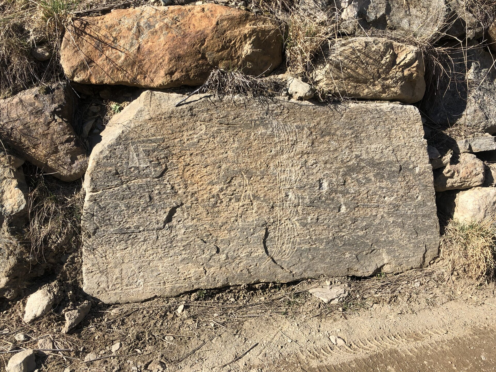
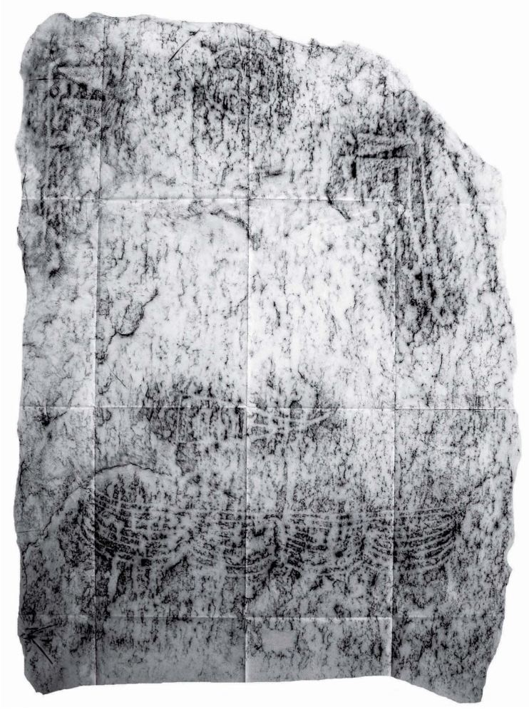

# La Stele di Migiondo

La Stele di Migiondo - Sondalo (SO) è conservata presso il
[Museo dei Sanatori di Sondalo](https://museodeisanatori.com/). Emersa alla luce
nella **primavera del 2016** durante i lavori per la realizzazione di una strada
privata, è stata reimpiegata, non potendone scorgere il valore storico-culturale
in quanto sporca di terra, per la costruzione dell' adiacente muro a secco.
Rimasta ignorata per più di 2 a nni, il 24 novembre 2018 è stata notata dal
prof. **Ivano Gambarri** di Sondalo e subito segnalata tramite il prof.
**Francesco Pace** alla Soprintendenza della Lombardia.

Il 27 ottobre 2020, per motivi di conservazione e tutela, la Soprintendenza ha
provveduto a rimuoverla per collocarla nella sede attuale, organizzandone la
presentazione con relativa esposizione al pubblico dal 10 luglio al 28
agosto 2021. In tale occasione è stata prodotta una **documentazione sulla
stele**, sul relativo periodo preistorico e sul luogo del ritrovamento, qui
riproposta.

## Risorse

Ai seguenti link è pubblicata la documentazione relativa alla scoperta ed allo
studio della Stele di Migiondo:

- [Il Gigante Sepolto](https://media.archeologicovaltellinese.it/migiondo/il-gigante-sepolto-migiondo.pdf)
- [Note di Ivano Gambarri sul ritrovamento](https://media.archeologicovaltellinese.it/migiondo/gambarri-stele-migiondo.pdf)
